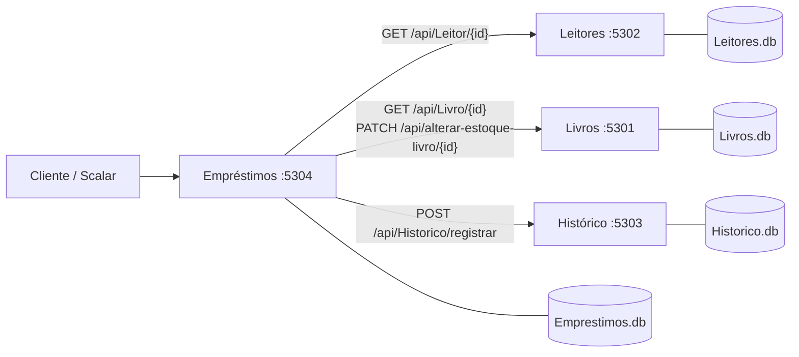
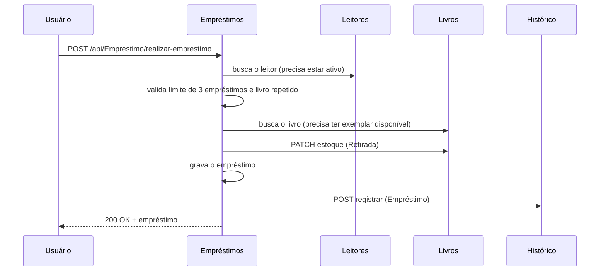

# Biblioteca — Microsserviços

**Disciplina:** Arquitetura de Software — SATC
**Integrantes:** Jenifer, Miguel e Paola
**Tecnologias:** C# / .NET 10, ASP.NET Core Web API, Entity Framework Core, SQLite, Scalar (documentação da API), Docker

---

## 1. Documento de requisitos

### 1.1 Propósito do sistema

O sistema tem como propósito gerenciar o funcionamento de uma biblioteca: manter o cadastro de livros e de leitores, controlar os empréstimos e as devoluções, atualizar automaticamente a quantidade de exemplares disponíveis e guardar o histórico de tudo o que aconteceu. Com ele, a biblioteca deixa de depender de controles manuais (cadernos e planilhas), evita emprestar um livro que não está disponível e passa a acompanhar os empréstimos atrasados.

Este trabalho entrega o **back-end** do sistema, em arquitetura de microsserviços, acessível por API REST.

### 1.2 Usuários

| Usuário | Como usa o sistema |
|---|---|
| **Bibliotecário / atendente** | Cadastra livros e leitores, realiza empréstimos e devoluções e consulta a situação do acervo. |
| **Coordenador da biblioteca** | Acompanha empréstimos atrasados, consulta o histórico por leitor, por livro ou por empréstimo e inativa leitores. |
| **Leitor** | É a pessoa cadastrada que pega os livros emprestados. Não opera o sistema diretamente; suas informações são consultadas pelo bibliotecário. |

### 1.3 Requisitos funcionais

| Código | Requisito | Microsserviço |
|---|---|---|
| RF01 | Cadastrar livros informando título, autor, ISBN e quantidade de exemplares, sem permitir ISBN repetido. | Livros |
| RF02 | Listar, buscar e editar livros. | Livros |
| RF03 | Controlar o estoque: retirar e devolver exemplares, sem deixar a quantidade disponível negativa ou maior que o total. | Livros |
| RF04 | Cadastrar leitores informando nome, e-mail e telefone, sem permitir e-mail repetido. | Leitores |
| RF05 | Listar, buscar e editar leitores. | Leitores |
| RF06 | Ativar e inativar leitores. | Leitores |
| RF07 | Realizar empréstimo, validando se o leitor está ativo, se não passou do limite de 3 empréstimos em andamento, se não está com outro exemplar do mesmo livro e se há exemplar disponível. O prazo de devolução é de 14 dias. | Empréstimos |
| RF08 | Devolver livro, atualizando o empréstimo e o estoque, e impedindo a devolução repetida. | Empréstimos |
| RF09 | Consultar empréstimos: todos, por código, por leitor e atrasados. | Empréstimos |
| RF10 | Registrar automaticamente no histórico cada empréstimo e cada devolução. | Histórico |
| RF11 | Consultar o histórico: completo, por leitor, por livro e por empréstimo. | Histórico |
| RF12 | Informar, no histórico da devolução, se o livro voltou no prazo ou com quantos dias de atraso. | Histórico / Empréstimos |

---

## Descritivo técnico

As seções a seguir descrevem os microsserviços que compõem o sistema, a função de cada um, as integrações entre eles e como o projeto foi construído.

## 2. Visão geral

Neste trabalho desenvolvemos o sistema de uma biblioteca dividido em **quatro microsserviços**, um para cada funcionalidade pedida: **Livros**, **Leitores**, **Empréstimos** e **Histórico**.

Tomamos como base o exemplo apresentado em aula (ContaBancaria + MovimentosBancario). Nele, o serviço de movimentos guarda apenas o código da conta e chama, por HTTP, o serviço de contas para consultar a conta e alterar o saldo. Reproduzimos essa mesma ideia para a biblioteca: o serviço de **Empréstimos** guarda apenas os códigos do livro e do leitor e chama, por HTTP, os serviços de **Livros**, **Leitores** e **Histórico**.

Características da arquitetura:

- Cada microsserviço é um projeto independente, com seu **próprio banco de dados SQLite** e sua própria documentação (Scalar).
- Nenhum serviço acessa o banco de outro. Toda comunicação entre eles acontece pela **API HTTP**.
- Os serviços podem ser executados, alterados e publicados separadamente.

## 3. Os microsserviços

| Microsserviço | Porta local | Banco | Responsabilidade | Equivalente no exemplo |
|---|---|---|---|---|
| **Livros** | 5301 | `Livros.db` | Cadastro de livros e controle de exemplares disponíveis | ContaBancaria (dona do saldo) |
| **Leitores** | 5302 | `Leitores.db` | Cadastro de leitores e situação (ativo/inativo) | — |
| **Histórico** | 5303 | `Historico.db` | Registro de tudo o que aconteceu: empréstimos e devoluções | — |
| **Empréstimos** | 5304 | `Emprestimos.db` | Regras do empréstimo e da devolução; consome os outros três | MovimentosBancario (consome a conta) |



O serviço de Empréstimos é o **orquestrador**: é o único que chama outros serviços. Livros, Leitores e Histórico não dependem de ninguém, o que mantém o acoplamento baixo.

## 4. Integrações entre os microsserviços

Todas as integrações partem do serviço de **Empréstimos**, que chama os demais por HTTP (REST).

| Nº | Tipo | Origem → Destino | Chamada | Finalidade |
|---|---|---|---|---|
| 1 | **Busca de dados simples** | Empréstimos → Leitores | `GET /api/Leitor/{id}` | Verificar se o leitor existe e se está ativo antes de emprestar. |
| 2 | **Busca de dados simples** | Empréstimos → Livros | `GET /api/Livro/{id}` | Verificar se o livro existe e se há exemplar disponível. |
| 3 | **Alteração de dados** | Empréstimos → Livros | `PATCH /api/alterar-estoque-livro/{id}` | Ao emprestar, o serviço de Empréstimos dispara a retirada de um exemplar no serviço de Livros; ao devolver, dispara a devolução do exemplar. |
| 4 | Alteração de dados (adicional) | Empréstimos → Histórico | `POST /api/Historico/registrar` | Registrar o empréstimo e a devolução no histórico. |

As integrações 1, 2 e 3 correspondem às integrações mínimas exigidas no enunciado (duas buscas simples e uma alteração de dados entre microsserviços). A integração 4 é um acréscimo.

## 5. Modelo de dados

**Livro** (serviço de Livros)

| Campo | Tipo | Descrição |
|---|---|---|
| Id | Guid | Identificador |
| Titulo | string | Título do livro |
| Autor | string | Autor |
| Isbn | string | ISBN (único) |
| QuantidadeTotal | int | Total de exemplares da biblioteca |
| QuantidadeDisponivel | int | Exemplares que estão na estante |
| DataCadastro | DateTime | Data do cadastro |

**Leitor** (serviço de Leitores)

| Campo | Tipo | Descrição |
|---|---|---|
| Id | Guid | Identificador |
| Nome | string | Nome do leitor |
| Email | string | E-mail (único) |
| Telefone | string | Telefone |
| Ativo | bool | Leitor inativo não pode fazer empréstimos |
| DataCadastro | DateTime | Data do cadastro |

**Emprestimo** (serviço de Empréstimos)

| Campo | Tipo | Descrição |
|---|---|---|
| Id | Guid | Identificador |
| CodigoLivro | Guid | Código do livro (no serviço de Livros) |
| CodigoLeitor | Guid | Código do leitor (no serviço de Leitores) |
| DataEmprestimo | DateTime | Data em que o livro foi emprestado |
| DataPrevistaDevolucao | DateTime | Data do empréstimo + 14 dias |
| DataDevolucao | DateTime? | Preenchida quando o livro é devolvido |
| Status | enum | 1 = EmAndamento, 2 = Devolvido |

**RegistroHistorico** (serviço de Histórico)

| Campo | Tipo | Descrição |
|---|---|---|
| Id | Guid | Identificador |
| DataEvento | DateTime | Data e hora do evento |
| TipoEvento | enum | 1 = Emprestimo, 2 = Devolucao |
| CodigoEmprestimo / CodigoLivro / CodigoLeitor | Guid | Códigos relacionados ao evento |
| TituloLivro / NomeLeitor | string | Cópia do título e do nome no momento do evento |
| Descricao | string | Texto descrevendo o que aconteceu |

O histórico guarda uma cópia do título e do nome do leitor. Assim, os registros continuam legíveis mesmo que esses dados sejam alterados depois, e a consulta ao histórico não precisa chamar os outros serviços.

## 6. Estrutura do código

Todos os serviços seguem a mesma organização, igual à do exemplo do professor:

```
Biblioteca/
├── Livros/
│   ├── Dockerfile
│   ├── LivrosApp.slnx
│   └── AppTemplate/
│       ├── Program.cs               # configuração: banco, CORS, Scalar, injeção de dependência
│       ├── DataContext.cs           # contexto do Entity Framework
│       ├── DataContextFactory.cs    # usado apenas para gerar as migrations
│       ├── appsettings.json         # string de conexão (e URLs dos outros serviços)
│       ├── Controllers/             # endpoints HTTP
│       ├── Servicos/                # entidades, regras de negócio e clients HTTP
│       └── DTO/                     # objetos de entrada e saída da API
├── Leitores/        (mesma estrutura)
├── Historico/       (mesma estrutura)
├── Emprestimos/     (mesma estrutura + clients HTTP na pasta Servicos)
├── docker-compose.yml
└── README.md
```

Responsabilidade de cada camada:

- **Controller:** recebe a requisição, converte o DTO na entidade, chama o serviço e devolve `Ok` ou `BadRequest` com a mensagem de erro.
- **Servico (`Serv...`):** concentra as regras de negócio e valida os dados antes de gravar.
- **DTO:** define o formato dos dados que entram e saem da API, sem expor a entidade diretamente nas entradas.
- **Client (`...Client`):** só existe no serviço de Empréstimos e isola as chamadas HTTP para os outros serviços.
- **DataContext:** mapeia as entidades para as tabelas do SQLite.

## 7. Como o serviço de Empréstimos se comunica com os outros

Existe um client para cada serviço consumido: `LivroClient`, `LeitorClient` e `HistoricoClient`. Eles são registrados no `Program.cs` com `AddHttpClient`, e a URL de cada serviço fica no `appsettings.json`:

```json
"LivrosUrl": "http://localhost:5301",
"LeitoresUrl": "http://localhost:5302",
"HistoricoUrl": "http://localhost:5303"
```

Exemplo do `LivroClient`, que consulta um livro e dá baixa no estoque:

```csharp
public async Task<BuscarLivroDTO> BuscarLivro(Guid codigoLivro)
{
    var metodoBuscarLivro = ObterUrl() + "/api/Livro/" + codigoLivro;
    var response = await _httpClient.GetAsync(metodoBuscarLivro);
    ...
    return await response.Content.ReadFromJsonAsync<BuscarLivroDTO>();
}

public async Task AlterarEstoque(Guid codigoLivro, AlterarEstoqueDTO alterarEstoqueDto)
{
    var metodoAlterarEstoque = ObterUrl() + "/api/alterar-estoque-livro/" + codigoLivro;
    var response = await _httpClient.PatchAsJsonAsync(metodoAlterarEstoque, alterarEstoqueDto);
    ...
}
```

Quando o serviço chamado devolve um erro, o client repassa a mensagem original. Se o serviço estiver fora do ar, o erro é "O micro de livros está indisponível" (ou leitores/histórico).

## 8. Regras de negócio

- O prazo do empréstimo é de **14 dias** (constante `PrazoEmDias` em `ServEmprestimo`).
- Cada leitor pode ter no máximo **3 empréstimos em andamento** (`LimiteEmprestimosPorLeitor`).
- Leitor **inativo** não pode fazer empréstimos.
- O mesmo leitor não pode pegar **dois exemplares do mesmo livro** ao mesmo tempo.
- Livro sem exemplar disponível não pode ser emprestado.
- ISBN único por livro e e-mail único por leitor.
- Ao editar um livro, se a quantidade total mudar, a quantidade disponível acompanha a diferença. Não é possível reduzir o total abaixo do número de exemplares emprestados.
- Não é possível devolver um empréstimo que já foi devolvido.
- A devolução registra no histórico se o livro voltou **no prazo** ou com **X dias de atraso**.

## 9. Fluxos principais

### 9.1 Realizar empréstimo



Trecho principal de `ServEmprestimo.RealizarEmprestimo`:

```csharp
var leitor = await _leitorClient.BuscarLeitor(emprestimo.CodigoLeitor);

if (!leitor.Ativo)
    throw new Exception("O leitor está inativo e não pode fazer empréstimos.");

// ... valida o limite de 3 empréstimos e se o leitor já está com o livro ...

var livro = await _livroClient.BuscarLivro(emprestimo.CodigoLivro);

if (livro.QuantidadeDisponivel <= 0)
    throw new Exception("Não há exemplares disponíveis deste livro.");

emprestimo.DataEmprestimo = DateTime.Today;
emprestimo.DataPrevistaDevolucao = DateTime.Today.AddDays(PrazoEmDias);
emprestimo.Status = EnumStatusEmprestimo.EmAndamento;

await _livroClient.AlterarEstoque(emprestimo.CodigoLivro, retirada);   // baixa no estoque

_dataContext.Add(emprestimo);
_dataContext.SaveChanges();

await RegistrarHistorico(...);                                          // registra no histórico
```

### 9.2 Devolver livro

`PATCH /api/Emprestimo/devolver-livro/{id}` faz o caminho inverso: devolve o exemplar ao estoque do serviço de Livros, muda o status para `Devolvido`, preenche `DataDevolucao` e registra no histórico a devolução, informando se houve atraso.

### 9.3 Consistência entre os serviços

Como cada serviço tem seu banco, não existe uma transação única. Para reduzir inconsistências:

- Se o empréstimo não puder ser gravado depois de o estoque ter sido reduzido, o serviço de Empréstimos **devolve o exemplar ao estoque** (compensação). O mesmo vale para a devolução.
- O registro no histórico é **"melhor esforço"**: se o serviço de Histórico estiver indisponível, o empréstimo continua valendo e o problema fica registrado no log (`ILogger`).

## 10. Endpoints

A documentação interativa de cada serviço fica em `http://localhost:<porta>/scalar`.

### Livros — `/api/Livro`

| Método | Rota | Descrição |
|---|---|---|
| POST | `/api/Livro/` | Cadastra um livro. Corpo: `{ "titulo", "autor", "isbn", "quantidadeTotal" }` |
| GET | `/api/Livro/` | Lista os livros |
| GET | `/api/Livro/{id}` | Busca um livro |
| PUT | `/api/Livro/{id}` | Edita um livro (mesmos campos do POST) |
| PATCH | `/api/alterar-estoque-livro/{id}` | Retira ou devolve um exemplar. Corpo: `{ "tipo": 1 }` (1 = Retirada, 2 = Devolucao) |

### Leitores — `/api/Leitor`

| Método | Rota | Descrição |
|---|---|---|
| POST | `/api/Leitor/` | Cadastra um leitor. Corpo: `{ "nome", "email", "telefone" }` |
| GET | `/api/Leitor/` | Lista os leitores |
| GET | `/api/Leitor/{id}` | Busca um leitor |
| PUT | `/api/Leitor/{id}` | Edita um leitor |
| PATCH | `/api/alterar-situacao-leitor/{id}` | Ativa ou inativa. Corpo: `{ "ativo": false }` |

### Empréstimos — `/api/Emprestimo`

| Método | Rota | Descrição |
|---|---|---|
| POST | `/api/Emprestimo/realizar-emprestimo` | Realiza um empréstimo. Corpo: `{ "codigoLivro", "codigoLeitor" }` |
| PATCH | `/api/Emprestimo/devolver-livro/{id}` | Devolve o livro do empréstimo |
| GET | `/api/Emprestimo/` | Lista todos os empréstimos |
| GET | `/api/Emprestimo/{id}` | Busca um empréstimo |
| GET | `/api/Emprestimo/atrasados` | Lista os empréstimos em andamento com prazo vencido |
| GET | `/api/Emprestimo/por-leitor/{codigoLeitor}` | Lista os empréstimos de um leitor |

### Histórico — `/api/Historico`

| Método | Rota | Descrição |
|---|---|---|
| POST | `/api/Historico/registrar` | Registra um evento (chamado pelo serviço de Empréstimos) |
| GET | `/api/Historico/` | Lista todo o histórico, do mais recente para o mais antigo |
| GET | `/api/Historico/por-leitor/{codigoLeitor}` | Histórico de um leitor |
| GET | `/api/Historico/por-livro/{codigoLivro}` | Histórico de um livro |
| GET | `/api/Historico/por-emprestimo/{codigoEmprestimo}` | Histórico de um empréstimo |

## 11. Exemplo de uso

**1. Cadastrar um livro** — `POST /api/Livro/`
```json
{ "titulo": "Dom Casmurro", "autor": "Machado de Assis", "isbn": "9788535910663", "quantidadeTotal": 2 }
```
Resposta:
```json
{
  "id": "3f6c1c2e-0b9a-4a52-9d5e-8a1f6a7b2c10",
  "titulo": "Dom Casmurro",
  "autor": "Machado de Assis",
  "isbn": "9788535910663",
  "quantidadeTotal": 2,
  "quantidadeDisponivel": 2,
  "dataCadastro": "2026-11-11T00:00:00"
}
```

**2. Cadastrar um leitor** — `POST /api/Leitor/`
```json
{ "nome": "Maria Souza", "email": "maria@email.com", "telefone": "48999999999" }
```

**3. Realizar o empréstimo** — `POST /api/Emprestimo/realizar-emprestimo`
```json
{ "codigoLivro": "<id do livro>", "codigoLeitor": "<id do leitor>" }
```
Resposta:
```json
{
  "id": "b2d4e7a1-5c3f-4f0e-8a6d-1c9e0f7a3b55",
  "codigoLivro": "<id do livro>",
  "codigoLeitor": "<id do leitor>",
  "dataEmprestimo": "2026-11-11T00:00:00",
  "dataPrevistaDevolucao": "2026-11-25T00:00:00",
  "dataDevolucao": null,
  "status": 1
}
```

**4.** `GET /api/Livro/{id}` agora mostra `quantidadeDisponivel: 1`.

**5. Devolver** — `PATCH /api/Emprestimo/devolver-livro/{id}`. O `status` passa para 2 e `quantidadeDisponivel` volta para 2.

**6. Consultar o histórico** — `GET /api/Historico/por-leitor/{id}` retorna dois registros, por exemplo:
```json
{ "tipoEvento": 1, "tituloLivro": "Dom Casmurro", "nomeLeitor": "Maria Souza",
  "descricao": "Empréstimo do livro 'Dom Casmurro' para Maria Souza. Devolução prevista para 25/11/2026." }
```

## 12. Mensagens de erro

Os erros de regra de negócio retornam **400 Bad Request** com a mensagem em texto, como no exemplo do professor. As principais:

| Situação | Mensagem |
|---|---|
| Leitor inativo | O leitor está inativo e não pode fazer empréstimos. |
| Limite atingido | O leitor já atingiu o limite de 3 empréstimos em andamento. |
| Livro repetido | O leitor já está com um exemplar deste livro. |
| Sem exemplares | Não há exemplares disponíveis deste livro. |
| Devolução repetida | Este empréstimo já foi devolvido. |
| ISBN duplicado | Já existe um livro cadastrado com este ISBN. |
| E-mail duplicado | Já existe um leitor cadastrado com este e-mail. |
| Serviço fora do ar | O micro de livros está indisponível. |

## 13. Como executar

**Pré-requisitos:** .NET 10 SDK e Visual Studio (ou outro editor com o comando `dotnet`).

### 13.1 Banco de dados

Ao iniciar, cada serviço prepara o seu próprio banco SQLite sozinho. Se o projeto tiver migrations do Entity Framework, elas são aplicadas (`Database.Migrate()`, como no exemplo do professor). Se não tiver, o banco é criado a partir do modelo (`EnsureCreated()`). Nenhum script precisa ser executado manualmente.

As migrations podem ser geradas, se desejado, com os comandos abaixo. Caso o banco (`.db`) já tenha sido criado antes, é preciso apagar o arquivo para que as migrations sejam aplicadas do zero.

No Visual Studio (Console do Gerenciador de Pacotes):
```
Add-Migration Primeiro -Project LivrosApp -StartupProject LivrosApp
Add-Migration Primeiro -Project LeitoresApp -StartupProject LeitoresApp
Add-Migration Primeiro -Project HistoricoApp -StartupProject HistoricoApp
Add-Migration Primeiro -Project EmprestimosApp -StartupProject EmprestimosApp
```

Ou pelo terminal:
```bash
dotnet tool install --global dotnet-ef
cd Livros/AppTemplate      && dotnet ef migrations add Primeiro
cd ../../Leitores/AppTemplate    && dotnet ef migrations add Primeiro
cd ../../Historico/AppTemplate   && dotnet ef migrations add Primeiro
cd ../../Emprestimos/AppTemplate && dotnet ef migrations add Primeiro
```

### 13.2 Subir os serviços

No Visual Studio, os quatro projetos ficam na mesma solução, configurada com **vários projetos de inicialização** (todos em "Iniciar") e o perfil `http`.

Pelo terminal, um serviço por janela:
```bash
cd Livros/AppTemplate      && dotnet run --launch-profile http
cd Leitores/AppTemplate    && dotnet run --launch-profile http
cd Historico/AppTemplate   && dotnet run --launch-profile http
cd Emprestimos/AppTemplate && dotnet run --launch-profile http
```

Com Docker:
```bash
docker compose up --build
```
O `docker-compose.yml` sobe os quatro serviços e já configura as URLs internas usadas pelo serviço de Empréstimos.

## 14. Decisões de arquitetura

- **Um banco por microsserviço:** cada serviço é dono dos seus dados e ninguém lê a tabela de outro.
- **Empréstimos guarda só os códigos** de livro e leitor e consulta os outros serviços no momento de validar, como o `CodigoConta` do movimento bancário no exemplo.
- **Clients HTTP dedicados** isolam as chamadas externas, da mesma forma que o `ContaBancariaClient` do exemplo.
- **Injeção de dependência** nos controllers e serviços (`AddScoped`, `AddHttpClient`), no lugar do `GeradorDeServicos` do exemplo, o que facilita testes e manutenção.
- **Chamadas assíncronas** (`async/await`) nos clients HTTP, evitando bloquear a thread com `.Result`.
- **Histórico com dados copiados** (título e nome), para que ele seja independente dos demais serviços.
- **Limitação conhecida:** não há transação distribuída entre os serviços. Implementamos uma compensação simples (devolver o estoque se a gravação falhar), mas uma solução completa usaria o padrão Saga ou mensageria (fila de eventos).

## 15. Publicação

O código-fonte está no GitHub e cada microsserviço é publicado como um **Web Service** independente no Render, usando o `Dockerfile` do template de cada projeto.

| Item | Endereço |
|---|---|
| Repositório no GitHub | https://github.com/JeniferSilvaVieira/Arquitetura_Biblioteca |
| Livros (Render) | https://LIVROS.onrender.com/scalar |
| Leitores (Render) | https://LEITORES.onrender.com/scalar |
| Histórico (Render) | https://HISTORICO.onrender.com/scalar |
| Empréstimos (Render) | https://EMPRESTIMOS.onrender.com/scalar |

Configuração de cada Web Service no Render:

- **Language:** Docker
- **Root Directory:** a pasta do microsserviço (`Livros`, `Leitores`, `Historico` ou `Emprestimos`)
- **Dockerfile Path:** `./Dockerfile`

O serviço de **Empréstimos** precisa conhecer o endereço dos outros três. No Render isso é feito com variáveis de ambiente, que sobrescrevem os valores do `appsettings.json`:

| Variável | Valor |
|---|---|
| `LivrosUrl` | endereço público do serviço de Livros |
| `LeitoresUrl` | endereço público do serviço de Leitores |
| `HistoricoUrl` | endereço público do serviço de Histórico |

Observações sobre o ambiente do Render:

- Os serviços do plano gratuito entram em repouso após um período sem uso, então a primeira requisição pode demorar alguns segundos.
- O SQLite grava em arquivo e, no plano gratuito, o disco é temporário: os dados são recriados quando o serviço reinicia. Para uso real seria necessário um disco persistente ou um banco gerenciado.
